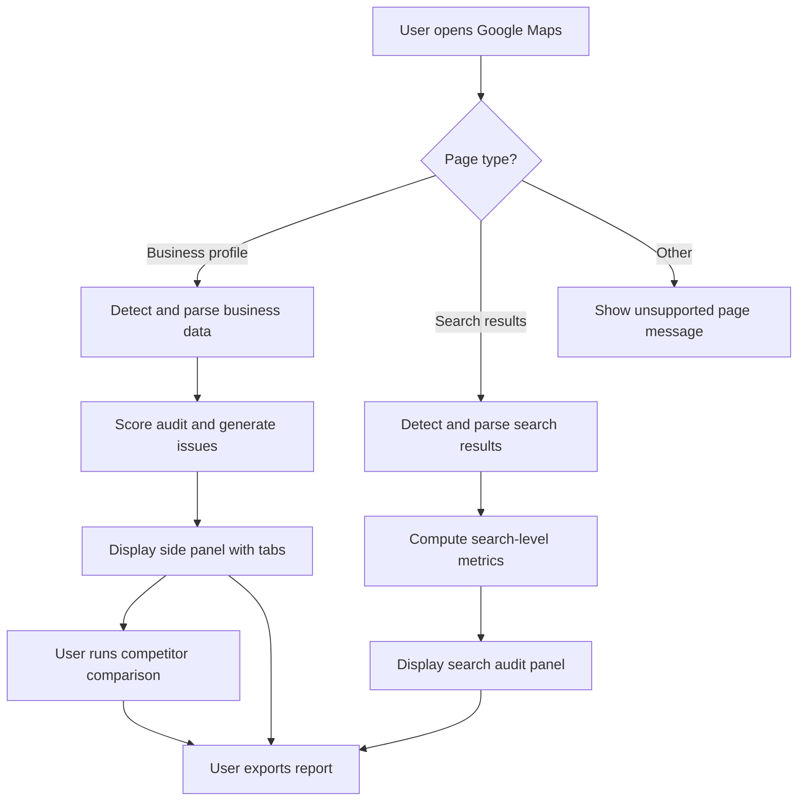

GBP Auditor is designed around two core user flows. The primary flow starts on a single business profile page and produces a detailed audit with competitor comparison. The secondary flow starts on a Maps search results page and produces a market-level analysis. Both flows are read-only, use only visible data, and keep all results locally.

## Primary flow: Audit a single business

This is the most common path. A Local SEO professional opens a Google Maps business profile and wants a full audit, scoring, and competitor comparison.

<Steps>
  <Step title="Navigate to a Maps business profile">
    The user searches Google Maps, clicks a business, and lands on the profile page. The content script detects the page type as `business-profile` using `GoogleMapsParser.detectPage()`.
  </Step>
  <Step title="Extension detects the page">
    The content script sends a `PAGE_DETECTED` message to the background service worker with the detected page type and URL. The popup, floating button, and side panel all receive this state update and show **Google Maps detected** with the current business name.
  </Step>
  <Step title="Trigger the audit">
    The user clicks **Audit Current Business** from the popup, floating button, or side panel. This sends an `AUDIT_BUSINESS` message to the content script.
  </Step>
  <Step title="Parse visible business data">
    The content script runs `GoogleMapsParser` methods to extract fields such as name, primary category, additional categories, address, phone, website, rating, review count, hours, services, attributes, description, photos count, and social links. Each extractor uses multiple fallback strategies (selectors, aria-labels, data attributes, text patterns). Unavailable fields return `"N/A"`. Failures return `"Not detected"`.
  </Step>
  <Step title="Score and generate issues">
    The audit engine scores the extracted data against the 100-point framework and generates checks with statuses: `PASS`, `WARNING`, `MISSING`, or `OPPORTUNITY`. Each check includes a human-readable explanation. For example, a services check may return `WARNING` with `"Only 4 services detected."`
  </Step>
  <Step title="Display results in the side panel">
    The side panel opens (or updates) with tabs for Overview, Audit, Categories, Services, Reviews, and Competitors. It shows the business header, overall score, quick signals checklist, opportunities count, and a **Full Audit** button for the detailed dashboard.
  </Step>
  <Step title="Run competitor analysis (optional)">
    The user clicks **Research Competitors** or opens the Competitors tab. The extension extracts visible competitors from the "People also search for" or nearby results on the Maps page. Each competitor gets rank, name, category, rating, reviews, website, phone, address, and services where visible.
  </Step>
  <Step title="Compare with a competitor (optional)">
    The user selects a competitor and clicks **Compare**. The comparison page renders rows for Primary Category, Additional Categories, Rating, Reviews, Services, Website, Hours, Attributes, Photos, Description, and Audit Score. Values are highlighted as Best, Average, or Missing.
  </Step>
  <Step title="Export the report">
    The user clicks **Export Report** and chooses a format: Print (browser print dialog), Save as PDF, Export CSV (business, category, rating, reviews, website, phone, address, audit score), or Export JSON (full structured audit). The report includes header, business name, date, overall score, and all audit sections.
  </Step>
</Steps>

## Secondary flow: Analyze a Maps search results page

This flow is useful for market research and competitive benchmarking across multiple businesses at once.

<Steps>
  <Step title="Perform a Maps search">
    The user searches for a keyword and location on Google Maps, such as `"plumber in Austin"`. The results page lists multiple businesses with cards.
  </Step>
  <Step title="Extension detects search results">
    The content script detects the page type as `search-results`. It sends the detection state to the background, and the popup updates to show **Search results detected** with the search query.
  </Step>
  <Step title="Trigger search audit">
    The user clicks **Analyze Search Results** from the popup or side panel. This sends an `AUDIT_SEARCH` message.
  </Step>
  <Step title="Extract visible competitors">
    The parser iterates over the visible result cards and extracts rank, business name, category, rating, review count, website, phone, and address for each entry. It stops at what is rendered; it does not scroll to load more unless the user explicitly requests it.
  </Step>
  <Step title="Compute search-level metrics">
    The extension calculates average rating, average reviews, top category, and other aggregates from the extracted results. It presents a table with columns: Position, Business, Rating, Reviews, Category, Website, and Audit (if individual audits were run).
  </Step>
  <Step title="Identify opportunities">
    The user reviews the search audit panel to spot gaps: businesses with low review counts, missing websites, or underrepresented categories. Opportunities are framed as "potential optimization opportunities" for the user's own client or business.
  </Step>
  <Step title="Export or save">
    The user exports the search audit as CSV or JSON, or saves individual businesses to the Favorites or History lists for later comparison.
  </Step>
</Steps>

## Loading and error states

Every flow must handle intermediate and failure states gracefully. The user should never see a blank screen or an unrecoverable crash.

| State | Behavior |
| --- | --- |
| **Detection in progress** | Skeleton loader with checklist: "Analyzing Business..." followed by progressive checkmarks for Business Information, Categories, Reviews, Website, and Competitors. |
| **Unsupported page** | Clear message: "This page is not supported." with a suggestion to open a Google Maps business or search page. |
| **Partial extraction** | Banner: "Some information could not be detected." Detected fields render normally; missing fields show "N/A" or "Not detected". |
| **DOM change during audit** | Detected fields are cached at the start of the audit. If the DOM changes significantly, the extension shows the cached result with a note: "Page content may have changed. Re-run the audit for current data." |
| **Website fetch pending** | When the user approves a website analysis, a spinner appears with "Fetching website..." until the fetch completes or times out. |
| **Network or runtime error** | Error boundary catches the error and displays a friendly message with an option to retry or report. No stack traces are shown to the user. |

## Flow diagram

